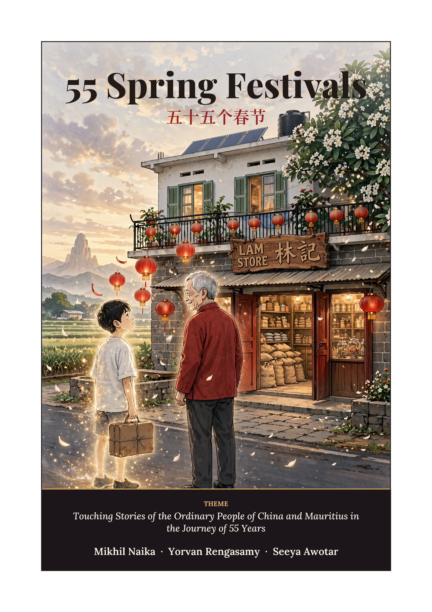
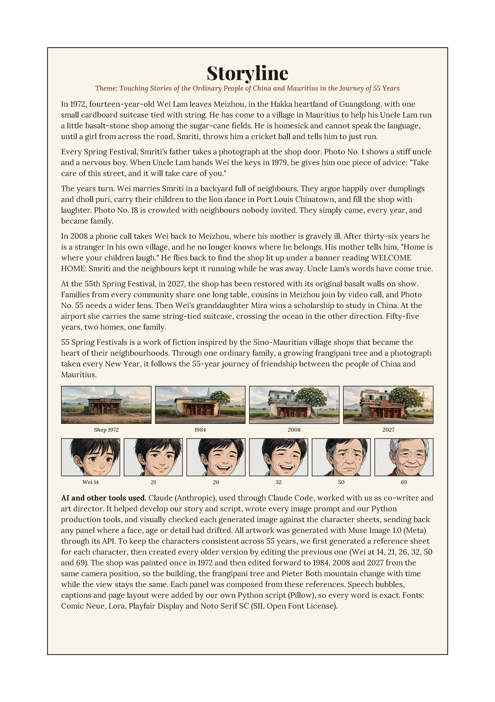
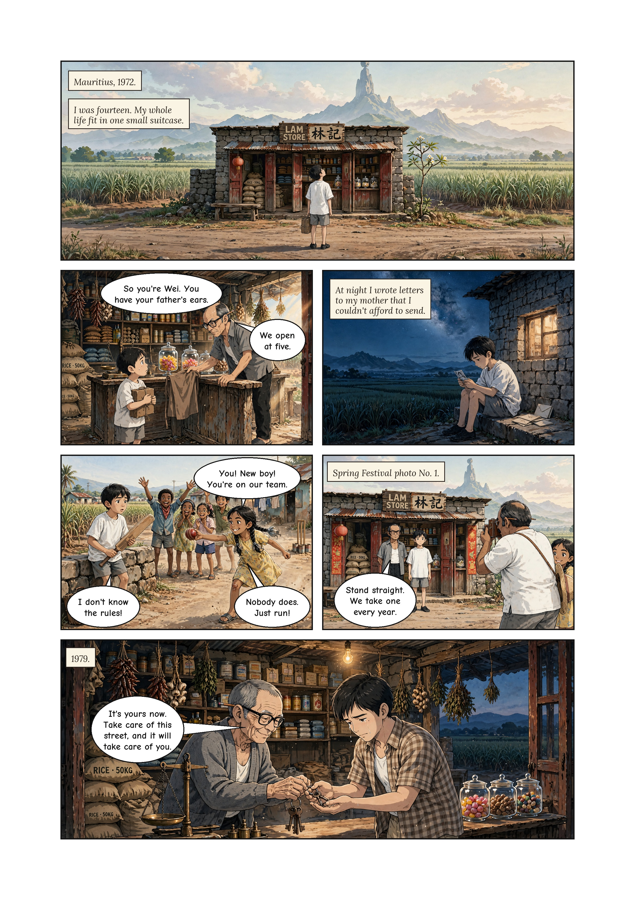
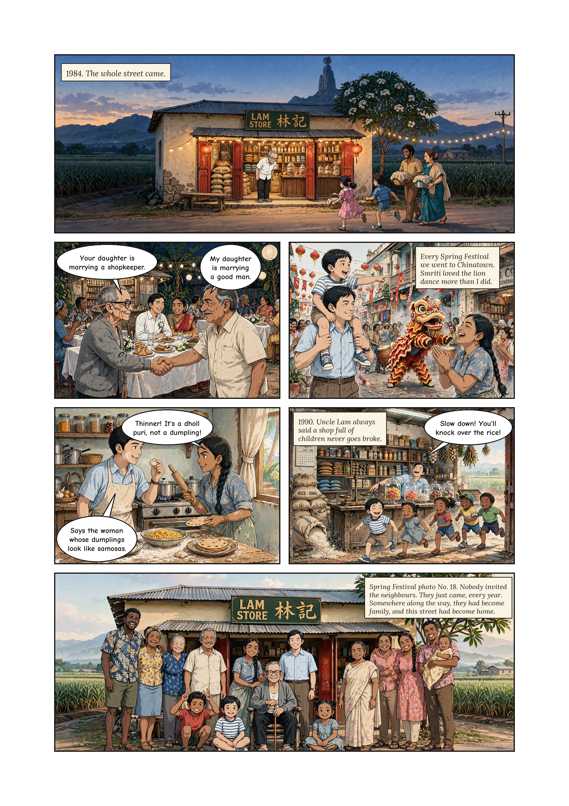
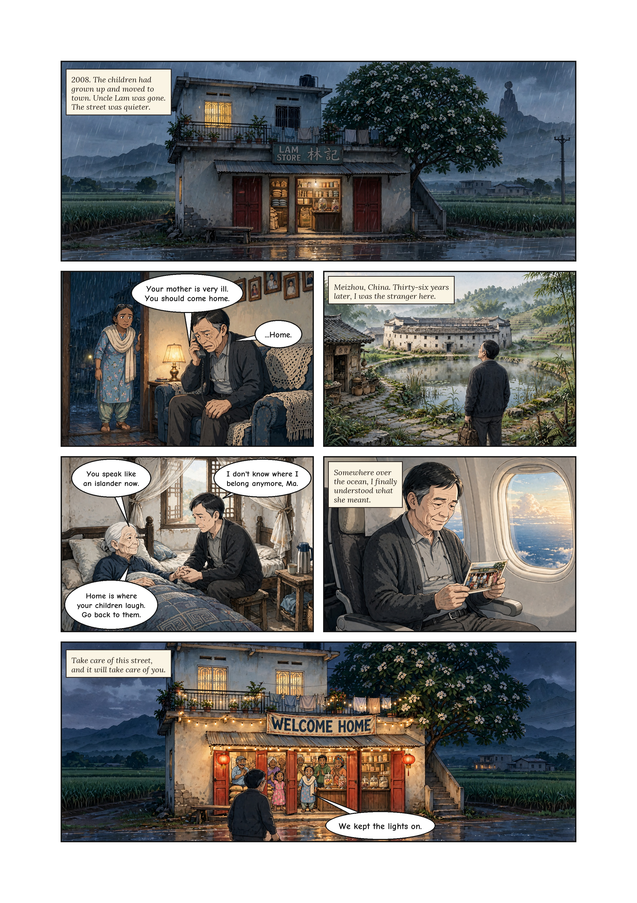
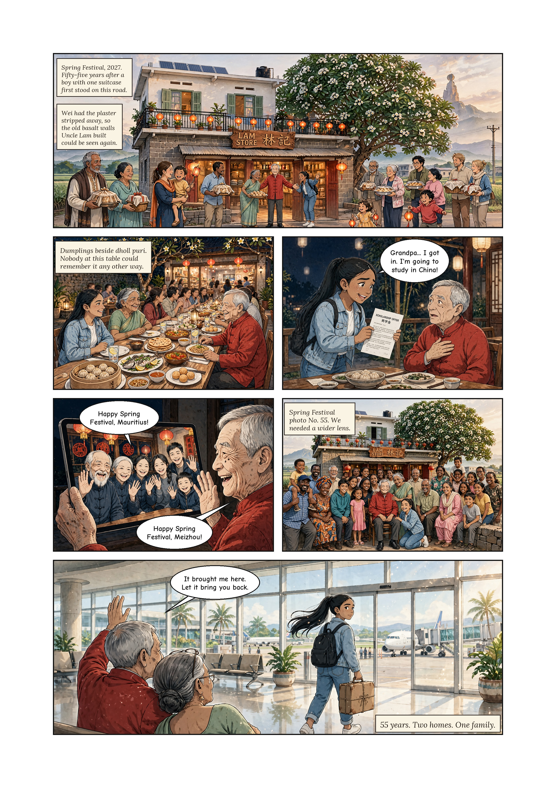

# 55 Spring Festivals · 五十五个春节

**A six-page comic: one Hakka family's village shop in Mauritius, across 55 years and 55 Spring Festivals.**

Our team's comic entry for the **China–Mauritius AI Storytelling Competition 2026**, theme *"Touching Stories of the Ordinary People of China and Mauritius in the Journey of 55 Years"*. Team: Mikhil Naika, Yorvan Rengasamy ([yorvan2401](https://github.com/yorvan2401)) and Seeya Awotar ([seeya0611](https://github.com/seeya0611)). The same story was also made into a short film with [Cutaway](https://github.com/Mikhil-sec/cutaway).

<p align="center">
  
</p>

## The story

In 1972, fourteen-year-old Wei Lam leaves Meizhou with one cardboard suitcase tied with string, to help his uncle run a basalt-stone shop among the sugar-cane fields. Every Spring Festival a neighbour takes a photograph at the shop door. Over 55 years the photos fill up with a marriage, children and a street that becomes family. In 2027 his granddaughter Mira crosses the ocean the other way, carrying the same suitcase.

## The pages

| | | |
|---|---|---|
|  |  |  |
|  |  |  |

Full-size pages are in [`showcase/`](showcase/).

## How it was made

- **Story and script:** written by the team with Claude (Anthropic, via Claude Code) as co-writer and art director ([`story/`](story/)).
- **Art:** every image was generated with **Meta's Muse Image 1.0** through its API.
- **Characters stay on-model across 55 years:** each character starts from a reference sheet, and every older version is an *edit* of the previous one (Wei at 14, 21, 26, 32, 50 and 69). The shop was painted once in 1972 and edited forward to 1984, 2008 and 2027 from the same camera position, so the building and the frangipani tree age while the view stays fixed.
- **Every panel was checked** against the character sheets, and panels where a face, age or detail had drifted were regenerated.
- **Lettering is code, not AI:** speech bubbles, captions and page layout are drawn by our own Python (Pillow) scripts, so every word is exact.
- **Hard spending cap:** the cost of each API call is reserved in a ledger *before* the request is sent, and never refunded, so a crash or a filtered image can only overestimate spending. The whole comic cost **$0.80** in image generation.

## Tools

| Script | What it does |
|---|---|
| [`tools/muse.py`](tools/muse.py) | Muse Image API driver (generate, edit with references), with the spend cap and a prompt log |
| [`tools/batch.py`](tools/batch.py) | Runs a JSON file of image jobs in dependency order (sheets before panels) |
| [`tools/layout.py`](tools/layout.py) | Assembles a page: A4 at 300 dpi, six panels, lettering |
| [`tools/frontmatter.py`](tools/frontmatter.py) | Builds the cover and the storyline page |
| [`tools/final_pdf.py`](tools/final_pdf.py) | Builds the competition's form pages and the final PDF (participants' documents stay local and are never committed) |

```
python -m venv .venv && .venv/Scripts/pip install -r requirements.txt
cp .env.example .env   # add your API key
.venv/Scripts/python tools/muse.py check
```

Fonts: Comic Neue, Lora, Playfair Display and Noto Serif SC (SIL Open Font License).
